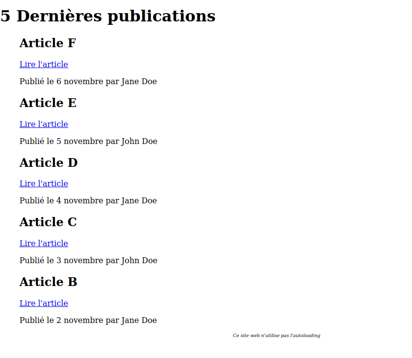

# Pratique : Projet fil rouge (mini CMS headless)

[Pratique : Projet fil rouge (mini CMS headless)](#pratique--projet-fil-rouge-mini-cms-headless)

- [Pratique : Projet fil rouge (mini CMS headless)](#pratique--projet-fil-rouge-mini-cms-headless)
  - [Spécifications](#spécifications)
  - [Module 01](#module-01)
    - [Partie 1 : *Vanilla* PHP](#partie-1--vanilla-php)
    - [Partie 2 : migration vers du PHP *moderne* avec Autoloading et Composer](#partie-2--migration-vers-du-php-moderne-avec-autoloading-et-composer)
    - [Partie 3 : Qualité](#partie-3--qualité)
      - [Appliquer les *coding standards* de Symfony](#appliquer-les-coding-standards-de-symfony)
      - [Utiliser le linter (analyseur statique) phpStan](#utiliser-le-linter-analyseur-statique-phpstan)
      - [Générer la documentation](#générer-la-documentation)
      - [Tests](#tests)
  - [Module 02](#module-02)

## Spécifications

- Le système est un mini *Content Managment System (CMS)*
- Le système d'afficher une liste de publications au format HTML sur sa page d'accueil, présentée du plus récent au plus ancien.
- Le système permet de configurer *le nombre de postes par page* (résultat paginé, cinq par défaut).

> Nous transformerons ce site en *service* web (API) au cours de la formation.

## Module 01

### Partie 1 : *Vanilla* PHP

1. **Préparer** le projet avec la structure suivante :

~~~php
demo_autoloading/
├── index.php            
├── config.php      
├── db.php (simulera une petite base de données)             
└── src/
    ├── Model/
        └── User.php
        └── Post.php   
~~~

1. **Créer** les modèles suivants :

   1. `User.php` définit une classe `User`. Un `User` est défini par :
      1. un **identifiant unique** (`int`),
      2. un **prénom** et un **nom**.

        Un `User` **peut être l'auteur·ice d'une ou plusieurs publications** (de type `Post`).
   2. `Post.php` définit une classe `Post`. Une publication (*post*) est définie par :
      1. un **identifiant unique** (`int`),
      2. un **slug**,
      3. un **titre**,
      4. une **date de publication** (de type [`DateTimeImmutable`](https://www.php.net/manual/fr/class.datetimeimmutable.php)),
      5. l'**identifiant de son auteur·ice** (de type `User`).

Les identifiants des `User` et `Post` **commencent à 1 et doivent être incrémentés de manière automatique**.

Les autres fichiers :

   1. Le fichier `index.php` est le **point d'entrée de l'application** (*core* et *controller*), produit la sortie,
   2. Le fichier `config.php` contient des éléments de configuration du projet:
      1. Définit une constante `ABS_PATH` égale à  `__DIR__ . '/'`. *Remarque : Cette constante vous sera utile pour importer vos scripts*;
      2. Définit une constante `POSTS_PER_PAGE` égale à `5`, indiquant **le nombre maximum de posts qui doivent être affichés** sur la page,
   3. Le fichier `db.php` simulera un accès à une source de données (base de données, service web, etc.). Il définit *deux* collections:
      1. `$users` : une collection de 2 users,
      2. `$posts` : une collection de 6 posts.

À sa racine (`/`), le site web doit **produire une page HTML** affichant la liste des publications **du plus récent au plus ancien**, avec le **template HTML** suivant :

~~~html
...
<h1> Dernières publications</h1>
<ul>
    <li>
        <article id="{id article}">
            <h2>{titre article}</h2>
            

                <a href="/{slug}">Lire l'article </a>
            

            <footer>
                

                    Publié le <time datetime="{date publication au format d:m:Y H:i}">{date en français. Ex : 16 mai}</time> par {prénom auteur·ice} {nom auteur·ice}.
                

            </footer>
        </article>
    </li>
    ...
</ul>
...
~~~

Pour trier les posts, **trouver** la fonction primitive PHP la plus adaptée [parmi cette liste](https://www.php.net/manual/en/array.sorting.php).

> Les données dynamiques sont indiquées entre accolades. **Conseil** : pour la date en français, utiliser un formateur international de dates [`IntlDateFormatter`](https://www.php.net/manual/fr/intldateformatter.create.php)

2. **Servir** le projet **avec le serveur intégré de PHP** sur l'URL `localhost:5001`;
3. **Tester** : `curl localhost:5001` ou [avec votre navigateur favori](http://localhost:5001). Que remarquez-vous sur la gestion des dépendances entre scripts ? Est-ce *simple* ? Est-ce *fun* ?

> L'*autoloading* a pour but de **régler tous ces problèmes**, une bonne fois pour toutes, *pour toujours* !

> [Accéder à/Télécharger une proposition commentée](https://github.com/paul-schuhm/eni-service-symfony-services-web/tree/main/demos/composer-autoloading/cms_sans_autoloading)

### Partie 2 : migration vers du PHP *moderne* avec Autoloading et Composer

1. **Refactoriser** le projet afin qu'il utilise **l'*autoloading* PSR-4 et le gestionnaire de dépendances Composer** :
   1. Initialiser le projet avec `composer init`;
   2. **Appliquer les modifications nécessaires** (retirer les `require`);
   3. Déplacer le fichier `congig.php` dans `src` pour qu'il soit chargé automatiquement;
   4. Commentaires :
      1. `index.php` joue le rôle de *client* du contenu `src`. Il invoquera l'*autoloader* (`require ./vendor/autoload.php`).
      2. Laisser `db.php` en dehors de la stratégie d'*autoloading*.

Voici la structure finale du projet :

~~~bash
├── composer.json
├── db.php
├── index.php
├── README.md
├── src
│   ├── config.php
│   └── Models
│       ├── Post.php
│       └── User.php
└── vendor
~~~

2. **Installer** [le composant var_dumper](https://symfony.com/doc/current/components/var_dumper.html)
3. L'**utiliser** dans `index.php` pour afficher la collection de posts.
4. **Créer** un fichier `.gitignore` correcte pour versionner le projet.

### Partie 3 : Qualité

#### Appliquer les *coding standards* de Symfony

~~~bash
# Lister les standards installés
phpcs -i
phpcs --standard=PSR12 src
~~~

Puis, pour **corriger** les violations qui peuvent l'être de manière automatique :

~~~bash
phpcbf --standard=PSR12 src
~~~

1. **Corriger** les autres manuellement.
2. **Vérifier** jusqu'à ce que `phpcs` retourne un code égal à 0 (aucune erreur) : `echo $?`

#### Utiliser le linter (analyseur statique) phpStan

<!-- A compléter -->

#### Générer la documentation

**Générer** la doc du dossier `src` :

~~~bash
docker run --rm -v "$(pwd):/data" phpdoc/phpdoc:3 -d src -t docs
~~~

#### Tests

**Créer** un test unitaire dans le fichier `tests/PostTest.php` :

~~~php
<?php

use PHPUnit\Framework\TestCase;
use Ps\App\Models\Post;

final class PostTest extends TestCase
{
    protected function setUp(): void
    {
        // Réinitialiser $last_id avant chaque test
        $reflection = new \ReflectionProperty(Post::class, 'last_id');
        $reflection->setAccessible(true);
        $reflection->setValue(null, 1);
    }

    public function testAutomaticIdIncrement(): void
    {
        $post1 = new Post(slug: 'first', title: 'First Post', date_publication: new \DateTimeImmutable(), author: 1);
        $post2 = new Post(slug: 'second', title: 'Second Post', date_publication: new \DateTimeImmutable(), author: 2);

        $this->assertSame(1, $post1->id);
        $this->assertSame(2, $post2->id);
    }
}
~~~

**Lancer** les tests :

~~~bash
./vendor/bin/phpunit --testdox tests
echo $?
~~~

## Module 02

<!-- a venir... -->